<!-- Custom Animated Cyberpunk Banner -->

  

<!-- Vibrant Typing Animation -->

  

<!-- Social & Competitive Programming Badges -->

  
  
  
  
  
  

<!-- Custom Animated Terminal & Skill Bars -->

  

<h3 align="center">🛠️ Tech Arsenal</h3>

  

<h3 align="center">🚀 Featured Engineering Projects</h3>

  
  
  
  

<h3 align="center">🏆 Achievements & Live Telemetry</h3>

  

  
  

  

  

<h3 align="center">🐍 Contribution Snake</h3>

  <picture>
    <source media="(prefers-color-scheme: dark)" srcset="https://raw.githubusercontent.com/NithishDev2005/NithishDev2005/output/github-contribution-grid-snake-dark.svg" />
    <source media="(prefers-color-scheme: light)" srcset="https://raw.githubusercontent.com/NithishDev2005/NithishDev2005/output/github-contribution-grid-snake.svg" />
    
  </picture>

<!-- dev-mode-v2 -->
